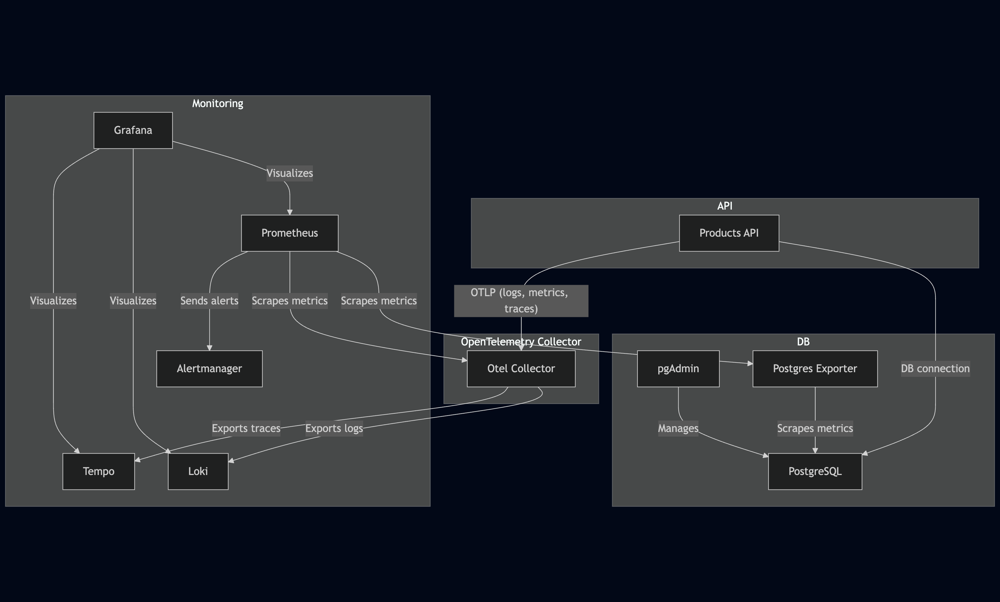

# o11y-logs-and-metrics

## Overview
This project provides a complete observability and monitoring stack for a .NET 8 Products API, including metrics, logs, and traces. The stack leverages OpenTelemetry, Grafana, Prometheus, Loki, Tempo, and PostgreSQL, all orchestrated via Docker Compose.

## Architecture



- **Products API**: .NET 8 REST API for managing products and categories.
- **PostgreSQL**: Database for storing product and category data.
- **pgAdmin**: Web UI for managing PostgreSQL.
- **OpenTelemetry Collector**: Receives logs, metrics, and traces from the API and routes them to the appropriate backends.
- **Prometheus**: Scrapes metrics from the Otel Collector and Postgres Exporter.
- **Grafana**: Visualization UI for metrics, logs, and traces.
- **Loki**: Stores logs for querying in Grafana.
- **Tempo**: Stores distributed traces for querying in Grafana.
- **Postgres Exporter**: Exposes PostgreSQL metrics for Prometheus.
- **Alertmanager**: Handles alerts from Prometheus.

## Services (Docker Compose)
- **products-api**: The main .NET 8 API. Sends logs, metrics, and traces to the Otel Collector.
- **postgres**: PostgreSQL database for the API.
- **pgadmin**: Web-based PostgreSQL admin tool.
- **otel-collector**: OpenTelemetry Collector, proxying all telemetry data to Loki, Prometheus, and Tempo.
- **prometheus**: Metrics collection and alerting.
- **grafana**: Visualization for metrics, logs, and traces.
- **loki**: Log aggregation and storage.
- **tempo**: Trace storage and search.
- **postgres-exporter**: Exposes PostgreSQL metrics for Prometheus.
- **alertmanager**: Alerting for Prometheus rules.

## Setup & Usage

### 1. Prerequisites
- Docker & Docker Compose installed

### 2. Configuration
- Replace all instances of `__password__` in the secrets and environment files with your own secure passwords before starting the stack.

### 3. Start All Services
```sh
docker-compose up --build -d
```

### 4. Stopping Services
```sh
docker-compose down -v
```

### 5. Useful Commands
- View logs for a service:
  ```sh
  docker-compose logs <service-name>
  ```
- Restart a service:
  ```sh
  docker-compose restart <service-name>
  ```

## Accessing the Stack
- **Grafana**: [http://localhost:3000](http://localhost:3000)
  - Default user: `admin`
  - Password: `secret`
- **pgAdmin**: [http://localhost:5050](http://localhost:5050)
  - Email: as set in your `.env` or Docker Compose
  - Password: as set in `Secrets/pgadmin_password.txt`

## API Endpoints
- `GET /products` — List all products
- `GET /products/{productId}` — Get a product by ID
- `GET /health` — Health check endpoint

## Monitoring & Observability
- **Metrics**: Collected by OpenTelemetry in the API, sent to Otel Collector, scraped by Prometheus, and visualized in Grafana.
- **Logs**: Exported via OpenTelemetry to Loki, visualized in Grafana.
- **Traces**: Exported via OpenTelemetry to Tempo, visualized in Grafana.
- **Alerts**: Prometheus rules trigger alerts, managed by Alertmanager.

## Notes
- Be sure to replace all `__password__` tokens in secrets and environment files before deploying to production.
- The stack is designed for local development and observability best practices.

---

For more details on each tool, see their official documentation:
- [OpenTelemetry](https://opentelemetry.io/)
- [Grafana](https://grafana.com/)
- [Prometheus](https://prometheus.io/)
- [Loki](https://grafana.com/oss/loki/)
- [Tempo](https://grafana.com/oss/tempo/)
- [PostgreSQL](https://www.postgresql.org/)
- [pgAdmin](https://www.pgadmin.org/)